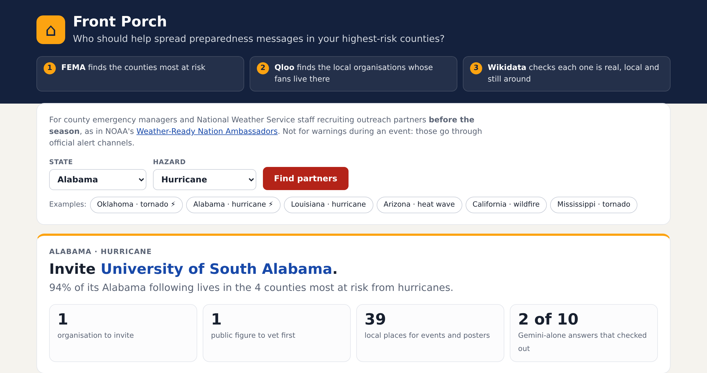
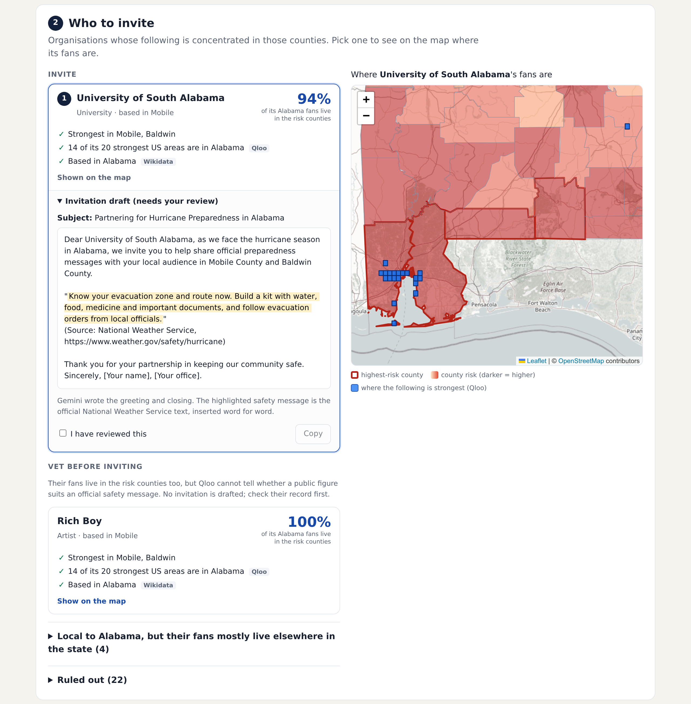

# Front Porch

**Before the season starts, find the local voices your highest-risk counties already follow, so preparedness messages reach the people who need them.**

Live: https://frontporch-556860386135.europe-west1.run.app (try `?state=AL&hazard=hurricane`)





Built for the Qloo Agentic Hackathon 2026. MIT licensed (see `LICENSE`); Qloo's data is not covered by that licence.

## The problem
Every spring a county emergency manager or National Weather Service meteorologist recruits local partners to repeat official safety messages. NOAA runs a formal programme for this, [Weather-Ready Nation Ambassadors](https://www.weather.gov/wrn/ambassadors). This happens months ahead of the season; warnings during an event go through official alert channels, and Front Porch plays no part in them. The hard part is not the message, it is the messenger: which teams, schools, businesses, venues and local artists does the population in the *highest-risk* counties actually follow? Ask a chatbot and you get plausible names: some from the wrong state, some defunct, some deceased, none with evidence of where their audience lives.

## What it does
1. **Where is the danger?** Reads FEMA's [National Risk Index](https://hazards.fema.gov/nri/) (county layer, December 2025 release) for the chosen state and hazard and picks the highest-risk counties.
2. **Who has a following there?** Asks Qloo which organisations and artists over-index around each of those counties (`qloo_recommend` with `signal_location`), and which real venues inside each county fit its taste (`target_type: place` with `filter_location`; Qloo's geocode confirms the county).
3. **Is that following local?** For every candidate, Qloo's `qloo_where_popular` across the whole US: a partner is local only if at least 10 of its 20 strongest US hotspots are in the state. National brands (Lululemon, Whole Foods) and out-of-state stars fail here.
4. **Does it cover the risk?** `qloo_where_popular` within the state; the share of the partner's following that falls inside the highest-risk counties. Partners local to the state but concentrated elsewhere drop to a "statewide" tier. Artists and other individuals go to a separate "public figures: vet before inviting" tier: Qloo shows where a following lives, not whether a person suits an official safety message.
5. **Independent check.** Wikidata: headquarters, home venue or origin in the state; date of death; date of dissolution. Religious and political entities are excluded.
6. **Gemini alone, checked the same way.** The same question goes to Gemini with no data; every name it returns runs through the same Qloo locality test and Wikidata check, side by side. A Gemini pick is only called "not local" when Wikidata also places it outside the state; Qloo alone makes it "can't verify", never wrong.
7. **Invitations.** Gemini drafts a greeting and closing for the top organisations (never for public figures); the official National Weather Service safety text is inserted by code, word for word; any number the model adds that is not in the evidence rejects the draft. A person approves every invitation.

## What we measured (live, Oct 20 2026)
- **Alabama · hurricane** (Mobile, Baldwin, Escambia, Covington counties): recommends the University of South Alabama (94% of its in-state following inside the risk counties; based in Mobile per Wikidata), lists Mobile rapper Rich Boy as a public figure to vet, and finds 39 taste-matched local venues across all four counties. Gemini alone suggested 10: 2 confirmed local (University of South Alabama, Coastal Alabama Community College), 2 wrong (the **Mobile BayBears, dissolved in 2019**, and rapper Bubba Sparxxx, from Georgia with fans mostly in Tennessee), and 6 that cannot be verified either way (local TV stations, venues, Mobile's mayor).
- **Oklahoma · tornado** (Oklahoma, Tulsa, Pottawatomie, Cleveland counties): recommends the Oklahoma City Blue, FC Tulsa, the University of Central Oklahoma and OKC Energy FC, lists six Oklahoma musicians (The Flaming Lips, John Moreland, Samantha Crain, Jabee and others) as public figures to vet, finds 58 local venues, and rejects national names surfaced along the way (following concentrated in other states). Gemini alone did well here: 5 of its 10 picks check out (Oklahoma City Thunder, University of Tulsa, Oklahoma State Fair and Garth Brooks confirmed by Qloo; Tulsa State Fair by Wikidata only); for the University of Oklahoma, Qloo and Wikidata disagree, so it is shown as conflicting, not wrong; 4 cannot be verified (local TV stations, Braum's, Love's).
- The Gemini answers shown are the ones recorded live on Oct 20 (the run current when the interface was finalised, not a selected run); they are pinned in `docs/baseline-seed.json` so the demo and this README agree across redeploys. Gemini's list varies from run to run; an earlier Alabama run named two Florida organisations (Pensacola Blue Wahoos, WEAR-TV).
- Gemini alone is not bad at this: it usually names a couple of genuinely local institutions. What it cannot do is show where each partner's audience lives relative to the risk, or find the venues; that is the part Qloo adds.
- Typical run: ~50–100 Qloo calls, 60–120 s live; repeated plans reuse cached evidence and show its fetch time.

## Honest limits
- Qloo affinity shows where a following is **concentrated relative to elsewhere**; it is not a head count, a measure of trust, or evidence that a message changes behaviour. Front Porch shortlists whom to invite; it does not predict reach.
- Choosing the messenger is one step of preparedness outreach, not the main barrier: many people know the risk and still lack the money, transport or time to act on it. Front Porch helps with that one step.
- The "local following confirmed by Qloo" row is 100% for Front Porch **by design** (it is the selection criterion); the independent comparison is the Wikidata row and the deceased/defunct/out-of-state catches.
- Qloo has no map for many local TV and radio stations; those show as "can't verify", never as wrong.
- The hackathon endpoint's `trends` tool returns no data, so nothing here depends on trends.
- Not an official NOAA, NWS or FEMA product.

## Run it
Node 22.19+, the pinned Qloo harness (`tooling/`), a Qloo hackathon key and a Gemini key.
```sh
npm ci --ignore-scripts && npm ci --prefix tooling --omit=dev --ignore-scripts
cp .env.example .env   # QLOO_API_KEY, GEMINI_API_KEY, GEMINI_MODEL=gemini-3.5-flash-lite, both QLOO base URLs
npm test               # 9 offline tests (fake Qloo/FEMA/Wikidata/Gemini)
npm run build && node --env-file=.env dist/server/index.js   # http://localhost:8080
node --env-file=.env --import tsx scripts/run-plan.ts AL hurricane   # one live plan from the terminal
```
Deploy: `deploy/cloudrun.sh` (Cloud Run, keys from Secret Manager, deployed by image digest).

## Data and licences
FEMA National Risk Index (US government, public) · Qloo hackathon API via the official `@qloo/qloo-harness` MCP server · Wikidata (CC0) · GeoNames cities15000 (CC BY 4.0, for labelling map cells by state) · map tiles © OpenStreetMap contributors · safety text adapted from weather.gov/safety (US government work).
